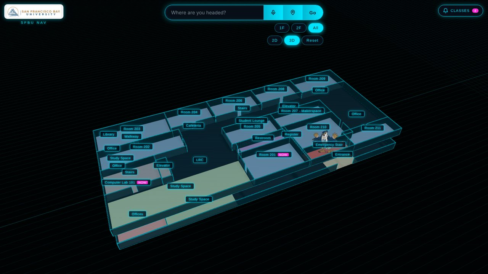
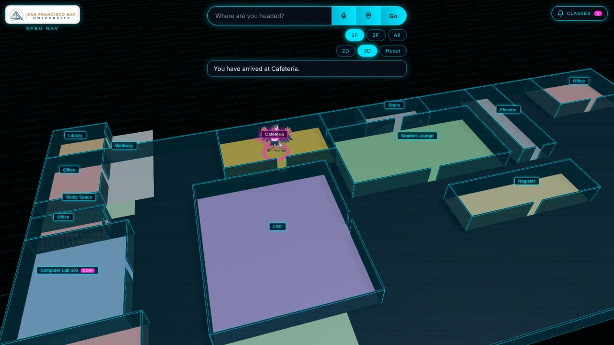
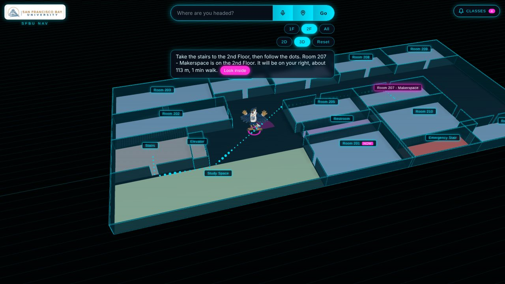
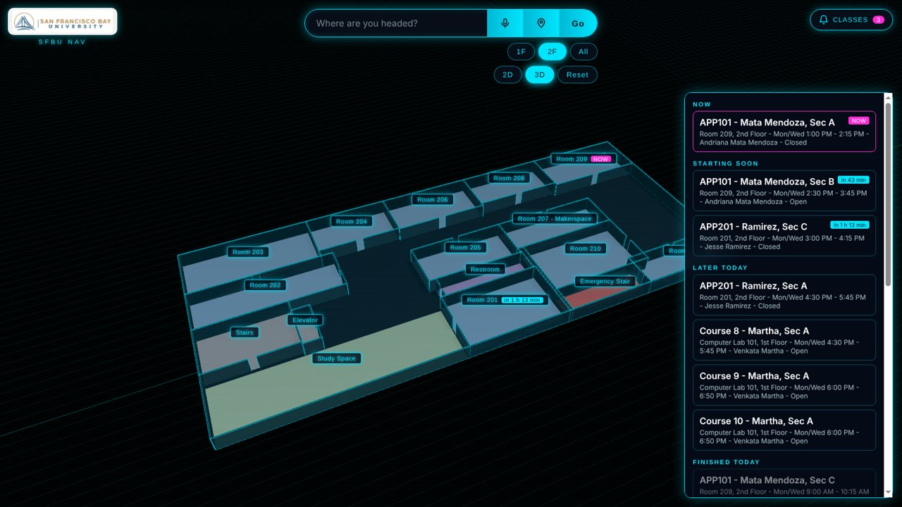
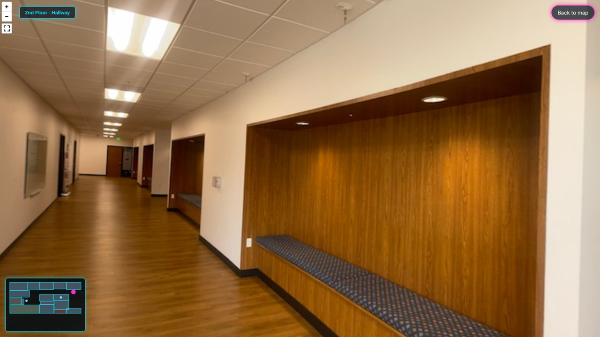

# nav.sfbu

**Ask. Follow the dots. Arrive.**

A 3D indoor map and campus guide for San Francisco Bay University. Ask in plain English, get a walking route across both floors, and see which classes are on right now. Every AI model runs locally on an NVIDIA DGX, so no student data leaves campus.




## Contents

- [Features](#features)
- [Screenshots](#screenshots)
- [Quick start](#quick-start)
- [Full setup on the DGX](#full-setup-on-the-dgx)
- [How it works](#how-it-works)
- [Edit the data](#edit-the-data)
- [Project structure](#project-structure)
- [Status and roadmap](#status-and-roadmap)
- [Notes](#notes)

## Features

| | |
|---|---|
| **3D map** | Both floors at real scale (about 85 m x 37 m), 1F / 2F / both, 2D or 3D |
| **Ask in plain English** | "I'm hungry", "where can I use a 3D printer?", "where is the Ramirez class?" |
| **Walking routes** | Glowing dots on the shortest path (A*), through doors and up the stairs, or the elevator for wheelchair users |
| **Directions** | "It will be on your right, about 50 m, 40 seconds walk." |
| **Mascot marker** | Drag it, double-click a floor to move it, and watch it walk the route |
| **Class schedule** | Rooms show NOW or "in 20 min"; the Classes panel lists every section and routes you there |
| **Campus guide chat** | "How do I..." answers from SFBU documents, with sources |
| **Real panoramas** | Look inside rooms before you walk there |
| **Where am I?** *(experimental)* | One photo places you on the map (DINOv2) |
| **Voice** *(experimental)* | Speak your question (Whisper), hear the answer |

## Screenshots

| Route on the same floor | Route to another floor |
|---|---|
|  |  |
| **Classes panel** | **Real panoramas** |
|  |  |

## Quick start

The map, routes, mascot, panoramas and class schedule run on any computer. Search uses keyword matching without the DGX.

```bash
git clone https://github.com/suxcii/nav.git
cd nav
python -m http.server 5500
```

Open http://localhost:5500. In VS Code you can also right-click `index.html` and choose **Open with Live Server**.

## Full setup on the DGX

```bash
# 1. AI engine and model
curl -fsSL https://ollama.com/install.sh | sh
ollama pull llama3.1:8b

# 2. Python packages
python3 -m venv ~/venv && source ~/venv/bin/activate
pip install -r backend/requirements.txt

# 3. AI server (terminal 1)
uvicorn backend.server:app --host 0.0.0.0 --port 8000

# 4. Website (terminal 2)
python3 -m http.server 5500
```

Open http://localhost:5500. `USE_AI` in `index.html` must be `true`.

<details>
<summary>No admin password on the DGX?</summary>

Run Ollama from your home folder:

```bash
mkdir -p ~/ollama && cd ~/ollama
curl -fL https://ollama.com/download/ollama-linux-arm64.tar.zst -o ollama.tar.zst
tar --zstd -xf ollama.tar.zst
~/ollama/bin/ollama serve &
~/ollama/bin/ollama pull llama3.1:8b
```
</details>

<details>
<summary>Campus guide chat options</summary>

- The first server start embeds the documents (about a minute) and caches them in `backend/rag_data/embeddings.npy`.
- Test the guide alone: `python -m backend.rag`
- Change the documents: edit `backend/rag_data/documents/`, run `python backend/ingest.py`, restart the server.
- The SFBU PDF handbooks are not included in this repo. The chat already works from `chunks.json`. To re-run `ingest.py` with them, download the handbooks from SFBU and put them in `backend/rag_data/documents/`.
- Use a bigger model: `RAG_MODEL=llama3.1:70b uvicorn backend.server:app --host 0.0.0.0 --port 8000`
</details>

## How it works

```
Floor sketches  ->  rooms in meters      ->  3D map in the browser (three.js)
Question        ->  backend (FastAPI)    ->  Llama 3.1 on the DGX  ->  room
Room + mascot   ->  A* on a 0.5 m grid   ->  dotted route + directions
Chat question   ->  MiniLM embeddings    ->  document chunks  ->  Llama  ->  answer + sources
Photo           ->  DINOv2 on the DGX    ->  closest panorama  ->  you are here
Voice           ->  Whisper on the DGX   ->  text  ->  same search
```

| Task | Model | Runs on |
|---|---|---|
| Understand questions, pick a room | Llama 3.1 8B (Ollama) | DGX |
| Campus guide chat | MiniLM + Llama 3.1 8B | DGX |
| Where am I? | DINOv2 | DGX |
| Speech to text | Whisper small | DGX |
| Map, routes, mascot | three.js + A* | Any browser |

Measured on our DGX Spark:

| Model | Speed | Size |
|---|---|---|
| Llama 3.1 8B | 41.6 tokens/s | 5 GB |
| Llama 3.1 70B | 3.63 tokens/s | 42 GB |

We use 8B in the app because instant answers matter when you are walking. The 70B also runs on the same DGX, which a normal laptop cannot do.

## Edit the data

Everything lives at the top of `index.html`:

| What | Where | Example |
|---|---|---|
| Rooms | `BUILDING` | `{ id: "room209", name: "Room 209", x: 67.5, z: 0, w: 17.5, d: 8.6, door: "bottom" }` |
| Classes | `SCHEDULE` | `{ room: "room209", course: "...", days: ["Mon", "Wed"], start: "14:30", end: "15:45" }` |
| Panoramas | `PHOTOS` | `{ id: "sfbu_hallway", file: "assets/photos/sfbu_hallway.jpg", floor: 2, x: 76, z: 11.5 }` |
| Camera icons | `SHOW_PHOTO_ICONS` | `false` hides them |

Floor plan tip: draw on grid paper with 1 square = 1 big step (about 1 m). The grid numbers go straight into `BUILDING`.

Test a different time of day: add `?time=2026-11-09T17:40` to the address.

## Project structure

```
nav/
├── index.html              the app: map, routes, mascot, panoramas, classes, chat
├── backend/
│   ├── server.py           /ask, /chat, /whereami, /transcribe
│   ├── rag.py              campus guide: retrieve + answer
│   ├── ingest.py           splits documents into chunks
│   ├── rag_data/           documents, chunks, cached embeddings
│   └── requirements.txt
├── assets/
│   ├── images/             mascot and logo
│   ├── photos/             panoramas (real SFBU photos + sample placeholders)
│   └── test_photos/        photos for testing Where am I?
├── docs/screenshots/       images for this README
├── README.md
└── LICENSE
```

## Status and roadmap

**Working:** 3D map of both floors, AI search on the DGX, routes across floors, mascot walking, class schedule, campus guide chat.

**Experimental:** Where am I? and voice are implemented but not yet tested end to end on the DGX.

**Next:**
- Spoken step-by-step guidance for blind and low-vision students
- More panoramas for better photo matching
- Evacuation simulation on the DGX GPU
- The same app for any school: nav.[your school]

## Notes

- Built for the NVIDIA DGX Hackathon by [Team name]: [Member 1], [Member 2], [Member 3].
- Floor plans are approximate, drawn by hand from walking the building.
- Class times come from SFBU Course Registration. Guide answers come only from the documents in `backend/rag_data/documents/` and are not official SFBU advice.
- Some panoramas show people. Ask for permission before publishing them, or blur faces first.

## License

The code is released under the [MIT License](LICENSE). The SFBU name, logo, mascot, SFBU documents and photos belong to their owners and are not covered by this license.
